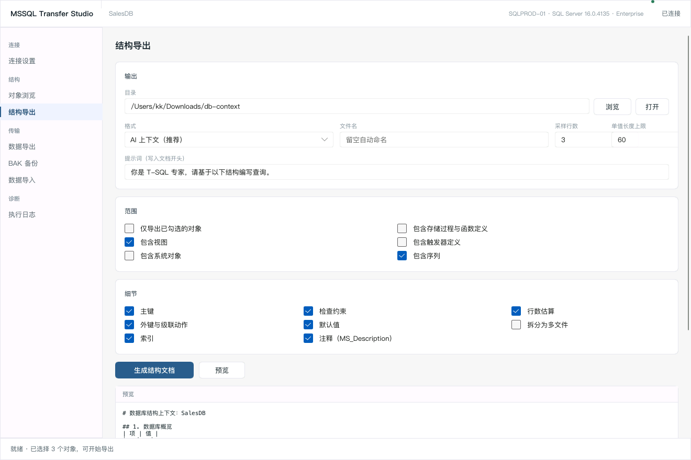
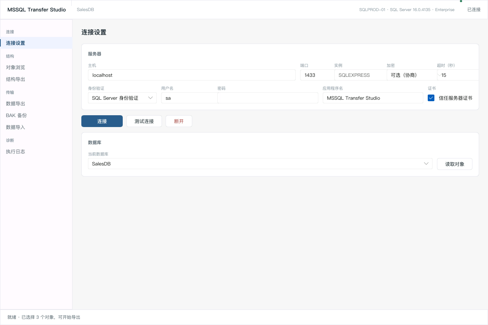
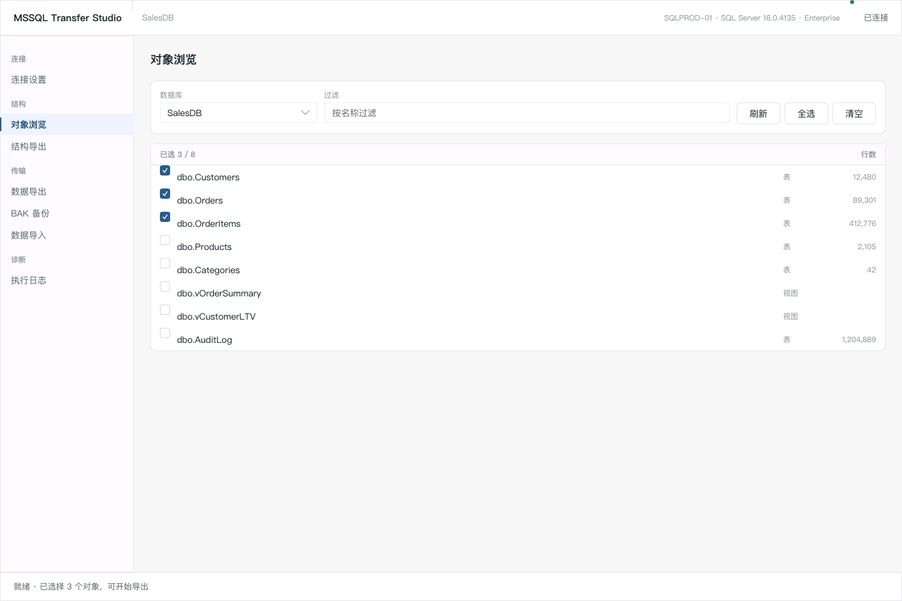
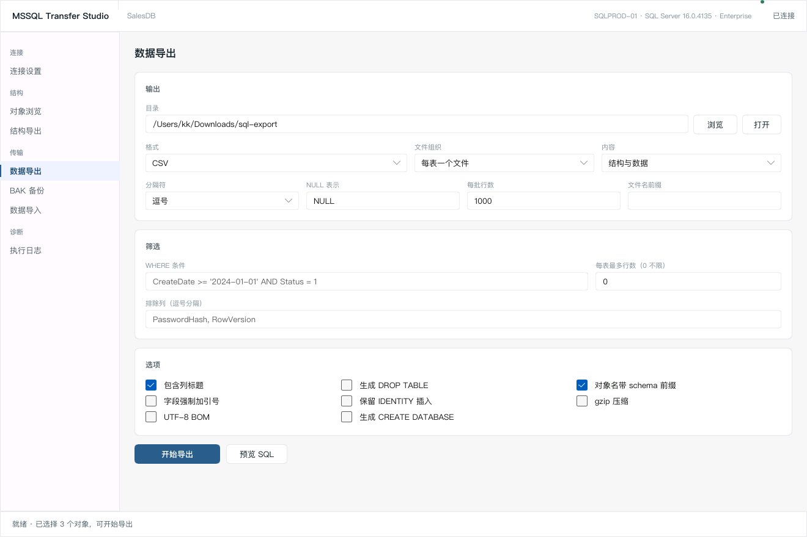
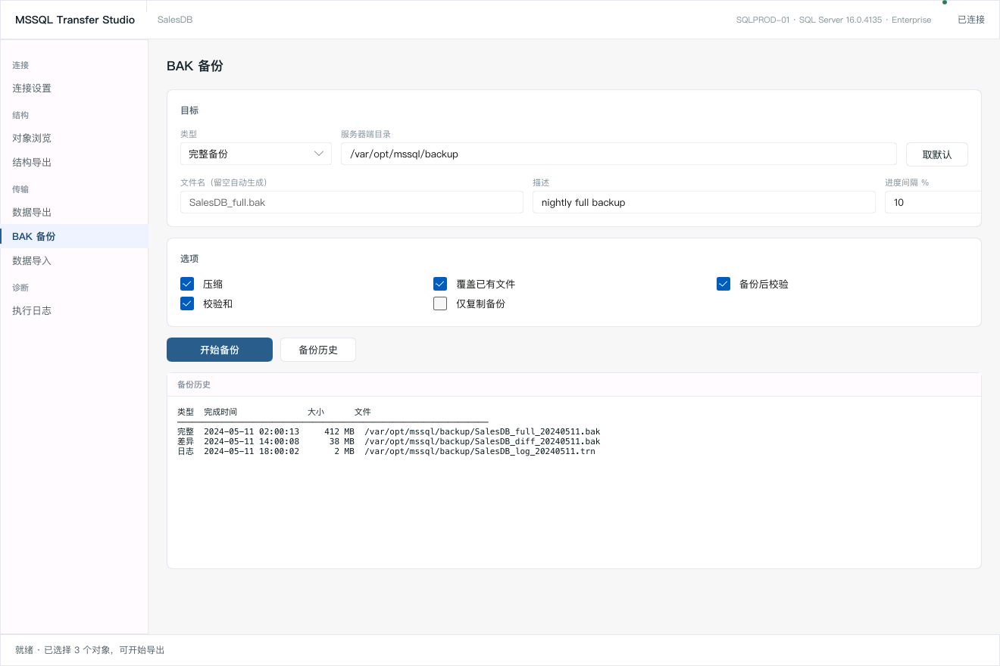
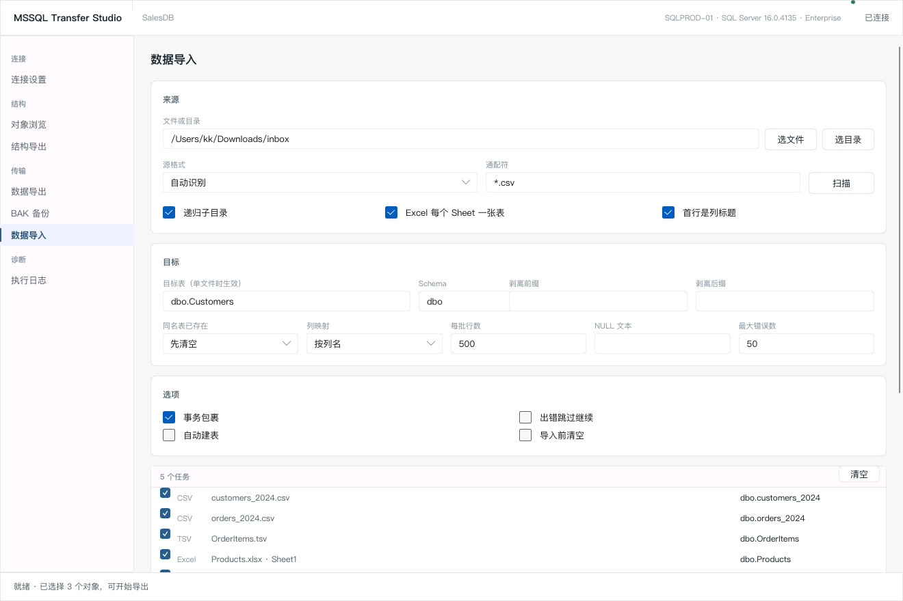
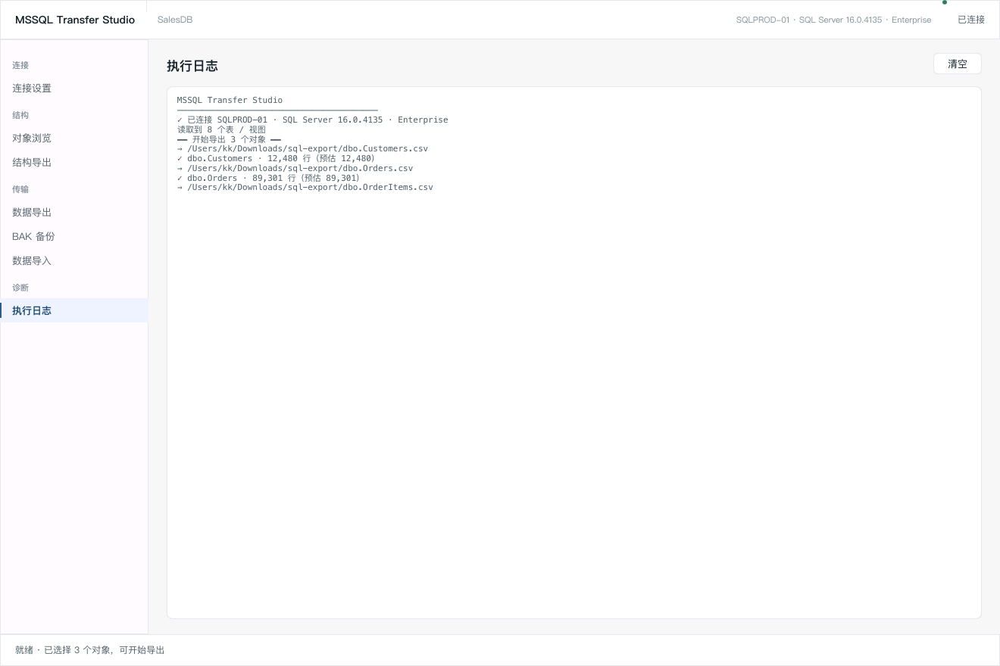

# MSSQL Transfer Studio

SQL Server 数据库 / 表 **结构导出 · 数据导出 · 备份 · 导入** 工具。**Rust + Slint** 构建的原生 GUI 应用，单文件分发，不需要 ODBC 或任何数据库客户端驱动。



## 为什么是这套技术栈

| 选择 | 原因 |
|------|------|
| **tiberius**（纯 Rust TDS 驱动） | 不需要安装 ODBC / FreeTDS / msodbcsql 等系统驱动，跨平台单文件分发 |
| **Slint** | 原生渲染、声明式 UI、内存占用低，编译期完成 UI 校验 |
| **tokio** | 数据库 IO 与 UI 线程隔离，导出百万行不卡界面 |
| **rust_xlsxwriter / calamine** | Excel 读写均无外部依赖，写出原生数值/日期单元格 |

## 界面

左侧按功能分组导航，右侧为对应配置面板，窗口可自由缩放（最小 1060×660，尺寸自动记忆）。

```
连接        连接设置    服务器 / 认证 / 加密 / 超时，测试与断开
结构        对象浏览    切换库、过滤、勾选表与视图
            结构导出    给 AI 读的库结构上下文 / DDL / ER 图 / JSON
传输        数据导出    CSV / TSV / JSON / NDJSON / SQL / Excel
            BAK 备份    完整 / 差异 / 事务日志 + 备份历史
            数据导入    CSV / TSV / JSON / Excel，批量递归队列
诊断        执行日志    完整执行轨迹
```

## 功能

### 连接
- 服务器 / 端口 / 具名实例（`SQLEXPRESS`）
- SQL Server 身份验证、Windows 集成验证（仅 Windows 构建）
- 加密策略：可选协商 / 强制 TLS（TDS 8.0 严格模式）
- 自签名证书信任、连接超时、自定义应用程序名
- 连接测试；连接后自动列出可访问数据库，并读取服务器默认备份目录

### 对象浏览
- 数据库切换（切换后自动重新读取对象）、表与视图列表、行数预览
- 名称实时过滤、全选 / 清空 / 单个勾选

### 结构导出（喂给 AI 的数据库上下文）

把这个库或这几张表的结构，整理成 AI 一眼能读懂的材料，直接贴给 Claude / ChatGPT / Copilot，让它照着写 SQL。

| 能力 | 说明 |
|------|------|
| 输出格式 | **AI 上下文**（Markdown，最多 8 节：概览 / 对象清单 / 关系 / 表结构详解 / 视图 / 模块定义 / 序列 / 注意事项）、纯 Markdown、**可执行 DDL**、**JSON 快照**、**Mermaid ER 图** |
| 范围 | 仅勾选对象 / 含视图 / 含系统对象 / 含存储过程与函数 / 含触发器 / 含序列 |
| 细节开关 | 主键、外键与级联动作、索引（含 INCLUDE 列）、检查约束、默认值、注释 `MS_Description`、行数估算 |
| 示例数据 | 每表采样 N 行（0–50）真实值，单值长度上限可调，二进制显示为 `<N bytes>` |
| 提示词 | 自定义头部提示词写进文件开头（默认「你是 T-SQL 专家…」） |
| 多文件包 | 单文件输出，或拆成 `00-overview.md` + `tables/` + `views/` + `schema.sql` + `er.mmd` + `schema.json`，按需投喂 |
| 预览 | 落盘前在界面内预览生成结果，确认后再写文件 |

**AI 上下文**末尾会自动生成「生成 SQL 的注意事项」小节，点明 AI 最容易写错的地方：IDENTITY 列不可显式插入、计算列不可写、无默认值的 NOT NULL 列必须显式赋值、无主键表不能按行定位、`decimal` 需保精度、`nvarchar(max)` 不可直接建索引，以及 T-SQL 方言要点（`OFFSET/FETCH`、`+` 拼接、`N'...'` 前缀、`[方括号]` 标识符、`IS NULL` 判断）。

> 典型用法：连上生产库 → 勾选相关表 → 格式选「AI 上下文」→ 生成 → 把 `00-overview.md` 贴进对话，让 AI 直接产出可执行的 T-SQL。
>
> 五种格式的实际输出见 [`docs/sample/`](docs/sample/)：`sample-ai-context.md`、`sample-schema.md`、`sample-schema.sql`、`sample-schema.json`、`sample-er.mmd`（由内置示例库生成，不需要连数据库）。

### 数据导出
| 能力 | 说明 |
|------|------|
| 格式 | CSV、TSV、JSON 数组、JSON Lines (NDJSON)、SQL INSERT 脚本、SQL 完整脚本（DDL + 数据）、**Excel (.xlsx)** |
| 文件组织 | 每表一个文件 / 全部合并为一个文件（Excel 合并时每表一个 Sheet） |
| 导出内容 | 结构与数据 / 仅结构 / 仅数据 |
| 分隔与转义 | 自定义分隔符、NULL 表示、列标题、全字段强制引号、UTF-8 BOM |
| SQL 脚本 | `DROP TABLE IF EXISTS`、`CREATE DATABASE`、`IDENTITY_INSERT` 包裹、`GO` 分批 |
| 数据裁剪 | 自定义 `WHERE` 条件、**每表最多 N 行（TOP）**、**排除指定列** |
| 压缩 | **gzip 输出**（`.csv.gz` / `.json.gz` / `.sql.gz`，Excel 不叠加） |
| Excel 细节 | 冻结首行、自适应列宽、表头加粗底色；Sheet 名自动去非法字符、截断 31 字符并去重 |
| 执行控制 | 流式读取（内存占用恒定）、实时进度 / 行数 / 字节数、可中途取消 |

### 备份（BAK）
| 能力 | 说明 |
|------|------|
| 类型 | 完整 `BACKUP DATABASE` / 差异 `WITH DIFFERENTIAL` / 事务日志 `BACKUP LOG` |
| 目标 | 服务器端目录（可一键取 `InstanceDefaultBackupPath`）+ 自定义文件名或自动命名 |
| 选项 | `COMPRESSION`、`CHECKSUM`、`INIT`、`COPY_ONLY`、`STATS = n`、`DESCRIPTION` |
| 安全 | 日志备份前检测恢复模式，`SIMPLE` 时明确报错而非静默失败 |
| 校验 | 备份后自动 `RESTORE VERIFYONLY` |
| 历史 | 查询 `msdb.dbo.backupset` 最近 15 条（类型 / 时间 / 大小 / 文件） |

> 备份文件由 SQL Server 服务账号在**服务器本机**创建，客户端不会收到文件副本；路径必须存在于服务器上且服务账号有写权限。

### 导入
| 能力 | 说明 |
|------|------|
| 格式 | CSV、TSV、JSON 数组、NDJSON、**Excel (.xlsx / .xlsm / .xlsb / .xls / .ods)**，或「自动识别」按扩展名推断 |
| 来源 | 单个文件，或整个目录 |
| **递归扫描** | 可递归遍历子目录；**文件名通配符**（`*` / `?`）过滤 |
| **多格式混排** | 一次任务可同时处理目录下的 CSV + TSV + JSON + Excel，各自按自身格式解析 |
| **Excel 多 Sheet** | 勾选后每个工作表拆成一个独立导入任务，Sheet 名即表名 |
| **任务队列** | 扫描生成可视化任务列表，可逐项启用 / 禁用、一键清空 |
| 表名推导 | 由文件名推导，支持**剥离前缀 / 后缀**；目标 schema 可指定；单文件时可用显式目标表覆盖 |
| 列映射 | 按列名匹配（忽略大小写）/ 按列顺序匹配 |
| 同名表策略 | 追加 `APPEND` / 先清空 `TRUNCATE` / 跳过 `SKIP` / 中止 `FAIL` |
| 目标表 | 不存在且勾选「自动建表」时按采样数据推断类型建表（整数自动区分 `int` / `bigint`） |
| 写入策略 | 参数化批量 INSERT（自动遵守 2100 参数上限）、事务包裹 |
| 容错 | 出错跳过并继续、最大错误数限制、整批失败自动降级为逐行重试 |
| 预览 | 导入前查看前 12 行解析结果（含 Excel 指定 Sheet） |

### 类型支持
`bit` `tinyint` `smallint` `int` `bigint` `real` `float` `money` `decimal/numeric`
`char/varchar/nchar/nvarchar/text/ntext` `binary/varbinary/image`
`date` `time` `datetime` `datetime2` `smalldatetime` `datetimeoffset`
`uniqueidentifier` `xml`

- 数值、布尔在 JSON 中保持原生类型，其余为字符串
- 二进制导出为 `0x...` 十六进制字面量；Excel 中写为十六进制字符串
- `decimal` 全程走 `Numeric`，不经过浮点，精度不丢失
- 导入时按目标列类型解析，日期支持多种格式（含 ISO 8601 与时区）
- Excel 单元格按列类型写成**原生 number / boolean / datetime**，而非全文本

## 下载安装

Release 提供四个平台的开箱即用包：

| 平台 | 文件 | 使用方式 |
|------|------|----------|
| macOS Apple Silicon | `mssql-transfer-macos-arm64.zip` | 解压得 `MSSQL Transfer Studio.app` |
| macOS Intel | `mssql-transfer-macos-x86_64.zip` | 同上 |
| Windows x64 | `mssql-transfer-windows-x86_64.zip` | 解压后运行 `mssql-transfer.exe` |
| Linux x64 | `mssql-transfer-linux-x86_64.tar.gz` | `tar xzf … && chmod +x mssql-transfer && ./mssql-transfer` |

**macOS 首次打开**：应用未做代码签名，若提示「已损坏」或「无法验证开发者」，执行一次即可：

```bash
xattr -dr com.apple.quarantine "/Applications/MSSQL Transfer Studio.app"
```

**Linux 运行依赖**：`libfontconfig1`、`libfreetype6`、`libssl3`（Ubuntu 22.04+ / Debian 12+ 默认具备）。

## 构建运行

```bash
# 需要 Rust 1.92+
cargo run --release

# 演示模式（填充示例数据，不需要数据库）
cargo run --release -- --demo

# 导出 7 个页面截图（软件渲染，无需显示器）
cargo run --release -- --screenshot ui.png

# 用内置示例库生成 5 种结构导出样例（无需数据库）
cargo run --release -- --sample-schema docs/sample

# 版本号
cargo run --release -- --version
```

macOS 打包为 `.app`：

```bash
./scripts/bundle-macos.sh                      # 默认 target/release + dist/
BIN=target/x86_64-apple-darwin/release/mssql-transfer \
  OUT_DIR=dist/x86_64 VERSION=0.1.0 ./scripts/bundle-macos.sh
open "dist/MSSQL Transfer Studio.app"
```

Linux 构建依赖：`pkg-config libssl-dev libfontconfig1-dev libfreetype6-dev`。

## 自动构建

仓库内置两条 GitHub Actions 流水线，无需任何 secret：

| 工作流 | 触发 | 内容 |
|--------|------|------|
| `.github/workflows/ci.yml` | push / PR / 手动 | `cargo fmt --check` → `cargo clippy -D warnings` → `cargo test`；再在 **macOS arm64、macOS x86_64、Windows x64、Linux x64** 四个目标各编译一次并跑 `--version` 冒烟 |
| `.github/workflows/release.yml` | 推送 `v*` tag / 手动填版本号 | 四目标并行编译 → 打包 `.app` / `.zip` / `.tar.gz` → 生成 `SHA256SUMS.txt` → 创建 GitHub Release 并附各平台下载表 |

发一个版本只需：

```bash
git tag v0.1.0 && git push origin v0.1.0
```

想临时出一个包，也可在 Actions 页面手动触发 `Release` 并填写版本号（留空则读 `Cargo.toml`）。

## 使用

1. 「连接设置」填服务器、端口、账号密码 → 连接
2. 「对象浏览」选数据库、勾选要处理的对象
3. **结构导出**：选目录与格式（默认 AI 上下文）→ 生成，或先预览
4. **数据导出**：选目录与格式 → 开始导出
5. **BAK 备份**：确认目录 → 开始备份（可查看历史）
6. **数据导入**：选文件或目录 → 设置通配符/递归 → 扫描生成任务 → 开始导入
7. 进度、行数、字节数在底部状态栏，详细日志在「执行日志」

配置（除密码外，含窗口尺寸与当前页面）自动保存到：
- macOS `~/Library/Application Support/mssql-transfer/config.json`
- Windows `%APPDATA%\mssql-transfer\config.json`
- Linux `~/.config/mssql-transfer/config.json`

## 端到端测试

仓库提供 Docker 测试环境：

```bash
docker compose up -d          # 启动 SQL Server 2022
./scripts/seed.sh             # 建库建表并灌入示例数据
cargo run --release           # 连接 localhost:1433 / sa / YourStrong!Passw0rd
```

`scripts/init.sql` 包含 3 张表（含主键、IDENTITY、decimal、datetime2、nvarchar、varbinary、NULL 值），覆盖主要类型路径。

## 项目结构

```
src/
├── main.rs           入口、UI 事件接线、配置映射、窗口尺寸记忆、离屏截图
├── bridge.rs         后台 tokio 线程 + 命令/事件通道
├── config.rs         配置持久化（密码不落盘）
├── model.rs          连接/结构/导出/备份/导入参数、计划项、事件定义
└── db/
    ├── conn.rs       TDS 连接、认证、加密
    ├── meta.rs       数据库/表/列/主键元数据、DDL 生成
    ├── schema.rs     结构快照采集 + 5 种渲染器（AI 上下文/DDL/JSON/Mermaid/Markdown）
    ├── value.rs      TDS 值 → Cell → JSON/SQL 字面量
    ├── export.rs     导出引擎（流式 + 多格式 Sink + gzip）
    ├── xlsx_out.rs   Excel 导出（原生单元格类型、多 Sheet）
    ├── backup.rs     BACKUP DATABASE / LOG、历史查询
    └── import.rs     导入引擎（扫描计划、多格式解析、批量写入）
ui/app.slint          Slint 界面（左侧分组导航）
scripts/              打包脚本、Docker 初始化 SQL
```

**线程模型**：Slint 事件循环独占主线程；后台单线程 tokio 运行时串行执行数据库任务；UI 事件经 `invoke_from_event_loop` 回主线程，避免任何共享可变状态跨线程。

## 已知限制

- **Windows 集成验证**依赖 `winauth`，仅在 Windows 目标构建可用；macOS/Linux 请用 SQL Server 身份验证
- **BAK 备份**只能在服务器端产生文件，不支持下载到客户端；跨机器取回需自行传输
- **结构导出**不读取数据库级权限、角色、同义词、分区方案；表值函数与标量函数只导出定义文本
- **CSV 合并模式**下，列结构不同的表会共用第一张表的表头，建议只对同构表使用
- **JSON 数组导入**需整体载入内存；超大文件建议改用 NDJSON
- CSV 中空字段一律视为 `NULL`，无法区分空字符串
- Excel 导入按整表读入内存，超大工作簿（百万行以上）建议先转 CSV
- 数据导出只带表结构与主键；索引、外键、约束、触发器等请用「结构导出」的 DDL 格式

## 测试状态

- **31 个单元测试**覆盖：SQL 字面量转义、decimal 精度、JSON 类型映射、CSV 合并表头、JSON 输出合法性、类型推断、日期/十六进制解析、gzip 往返、排除列解析、通配符匹配、表名推导、递归扫描计划、Excel Sheet 名去重与截断、Excel 写入→读取回环与多 Sheet 拆分，以及结构导出的 T-SQL 类型渲染、AI 上下文小节完整性、DDL 可执行性、Mermaid 关系与基数、JSON 快照完整性、提示词前置、采样值截断
- UI 七个页面均通过 Slint 软件渲染器截图核对布局（见 `docs/`）
- **数据库交互层尚未连接真实 SQL Server 做端到端验证**（开发环境无容器运行时）。首次使用请在测试库上验证，或按上面的 Docker 流程跑一遍

## 截图

| 连接设置 | 对象浏览 |
| --- | --- |
|  |  |

| 结构导出 | 数据导出 |
| --- | --- |
|  |  |

| BAK 备份 | 数据导入 |
| --- | --- |
|  |  |

| 执行日志 |
| --- |
|  |

## License

MIT
